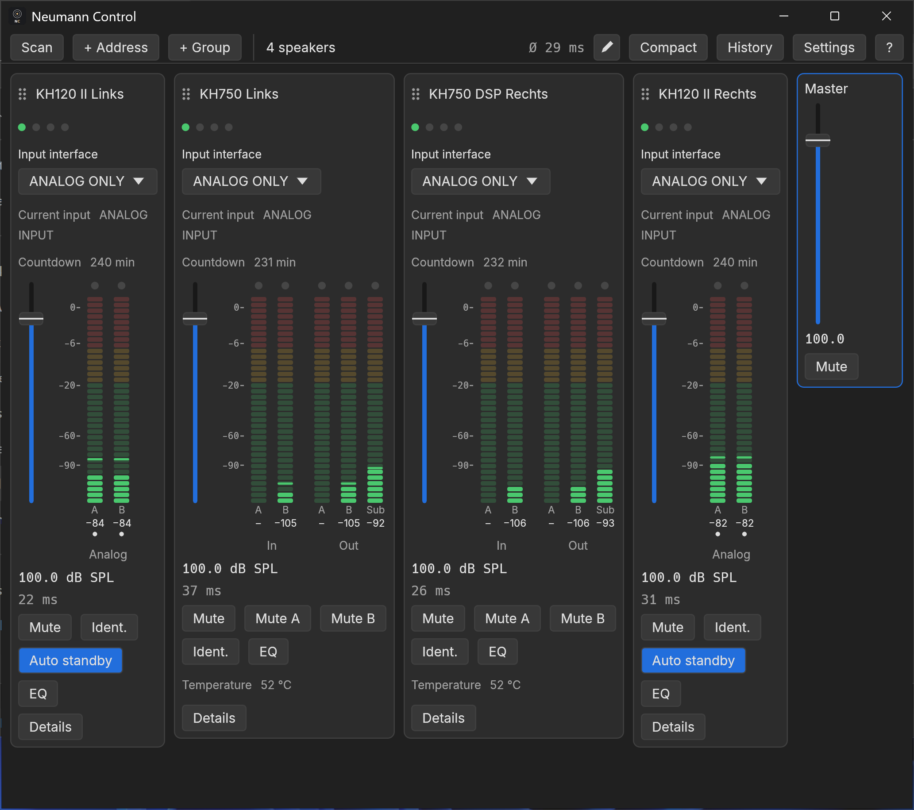

# Neumann Control


A portable Windows app to find, read and control Neumann KH DSP speakers over the network, using
the Sennheiser Sound Control protocol (SSC). It shows your speakers side by side like channel
strips on a desk, with level faders, meters, groups and a master.

> **Alpha.** This is an early version: expect rough edges and changes between versions, and keep
> an eye on your speakers' settings while you use it.
>
> This is an independent project. It is not affiliated with or endorsed by Neumann or
> Sennheiser.



*The desk with four speakers (two KH 120 II, two KH 750), the group strip "Front", and the device
panel of one KH 750 open. The interface is shown in German.*

## Contents

- [Highlights](#highlights)
- [Status](#status)
- [Requirements](#requirements)
- [Installation](#installation)
- [Getting started](#getting-started)
- [Using the app](#using-the-app)
- [How writes stay safe](#how-writes-stay-safe)
- [Supported models](#supported-models)
- [Files and privacy](#files-and-privacy)
- [Known limits](#known-limits)
- [Building from source](#building-from-source)
- [Licence](#licence)

## Highlights

- **Find speakers** on the local network (mDNS) and choose which to add, or add one by its IPv6
  address. Added speakers are remembered.
- **A desk of channel strips**: status LEDs, the input and the standby countdown, a level fader,
  input meters (on the KH 750 also its output meters), mute and identify; what a strip shows can
  be changed per model.
- **A device panel** per speaker with every setting the catalog knows for its model.
- **Groups and a master**: move or mute several speakers at once, and link settings within a
  group.
- **EQ** in a window of its own: a computed response graph and a table of the bands.
- **History and undo**: every write of the session, each one revertible, Ctrl+Z for the newest.
- **Presets** of chosen settings and of EQs, and a comparison of EQ curves between speakers.
- **Windows volume** of a playback device as a strip on the desk.
- **Compact mode** (Ctrl+K): one row per speaker or group in a small window.
- **German and English** interface, light and dark theme.
- **Portable**: one executable, settings and log next to it, no installer.

The interface follows the Windows display language: German on a German Windows, English on any
other. **Settings** → **Language** (in German: **Einstellungen** → **Sprache**) can fix one of
them. This README uses the English names.

## Status

Version 0.1.0, alpha. The protocol layer, the polling and the interface are covered by automated tests
against a built-in speaker simulator for the KH 120 II and the KH 750. On real KH 120 II and
KH 750 speakers the app was checked for scanning, reading, metering and writing level, mute,
identify and standby time. Groups, the compact mode and the English interface are so far covered
by the simulator tests only.

## Requirements

- Windows 10 or 11 with a DirectX 12 capable graphics adapter.
- The computer and the speakers on the same layer 2 network segment (same switch or VLAN). The
  speakers are reached over IPv6 link-local addresses, which are not routed.
- IPv6 enabled on the network adapter in use.
- To scan, the firewall must allow mDNS (UDP 5353) for the app. Adding a speaker by address needs
  only the speaker's TCP port 45.

## Installation

The app needs no installer. A release folder holds:

| File | Content |
|------|---------|
| `neumann-control.exe` | The app |
| `LICENSE` | The app's licence (MIT) |
| `THIRD-PARTY-LICENSES.html` | The licences of the libraries and fonts built into it |
| `SHA256SUMS` | Checksums of the files above |

Put the folder anywhere you can write to, for example in your documents, and start
`neumann-control.exe`. The app keeps its settings and log in that folder (see
[Files and privacy](#files-and-privacy)). To update, replace the executable; to remove the app,
delete the folder.

## Getting started

1. Start `neumann-control.exe` and press **Scan**. The scan takes 4 seconds. The dialog
   "Speakers found" lists every speaker found with its name, model and masked address. Check the
   ones you want and press **Add**; each gets a strip. Speakers that already have one are marked
   "already added". **Cancel** adds nothing.
2. If the scan finds nothing (for example because mDNS is blocked), press **+ Address** and enter
   the speaker's IPv6 address. A link-local address (`fe80::...`) needs the index of the network
   adapter after a `%`, for example `fe80::1%7`. Find the index in PowerShell:

   ```powershell
   Get-NetAdapter | Select-Object Name, ifIndex
   ```

   or with `netsh interface ipv6 show interfaces` (column `Idx`).

Added speakers are remembered and reconnected at every start. When a scan finds a remembered
speaker at a different address (link-local addresses and interface indexes can change), the
stored address is updated. The app scans for that by itself, without a dialog: once at the start,
and when a remembered speaker stays unreachable for 30 seconds, then at most every 5 minutes
while one is missing. Speakers are matched by their serial; one added by address that never
connected has none yet and is not followed. IPv4 addresses are not accepted: the speakers are
reachable only over IPv6.

## Using the app

### The desk

Each speaker has a channel strip:

- its name (click it to open the device panel) and a grip to drag the strip elsewhere,
- four LEDs: connection, clip, device warning, and LOCAL (the rear CONTROL switch locks writing),
- by default the **Input interface** (a choice), the **Current input** and the standby
  **Countdown**; set-up values such as the delay, the standby time and the logo brightness are in
  the device panel,
- the output level fader (0–120 dB SPL in 0.5 dB steps) with its value below,
- input meters for channels A and B with clip lamps; the KH 750 also shows its output meters A, B
  and Sub, captioned "Out". A thin line marks each meter's peak of the last 1.5 seconds, and the
  number under the channel shows it in whole dB ("–" below the meter range),
- the response time, and by default **Mute**, **Ident.** (identify) and **EQ**, which opens the
  speaker's EQ window once the speaker has reported its model; on the KH 120 II also
  **Auto standby**, on the KH 750 **Mute A** and **Mute B** for its outputs A and B and its
  **Temperature**. Above the fader every model shows the same, so the faders of a mixed desk
  stand level,
- **Details** at the foot, which opens the device panel.

What a strip shows besides its name, LEDs, fader, meters and message is set per model, for every
speaker of that model at once:

- Right-click a knob or button on a strip to **Hide** it, **Swap for …** another setting, or move it
  up or down (past the fader too). Right-click a row in the device panel to put it on the strip
  (**Add to strip**) or take it off.
- **↕** in the toolbar (**Customize strips**) switches every strip into edit mode: **×** hides an
  element, **+ Add** adds one, dragging an element moves it (also across the fader), and
  **Default** brings back the strip above. The controls write nothing while you edit; **↕** again
  (**Done**) ends it.
- Any number, switch, choice or read-only value of the device panel can go on a strip; the
  device name and lists such as the input mix stay in the panel.

On the KH 120 II the input meters are captioned with the rear input switch (Analog, AES3 L,
AES3 R, Mono), and a dot marks the channels the speaker plays. That channel A is the left AES3
channel is assumed, not measured.

The toolbar shows the number of speakers (not in the narrowest window) and the average response
time of the connected ones.

### Faders and knobs

- **Fader**: grab it anywhere and drag; it moves with the pointer and never jumps to it. Shift
  makes it ten times finer, and the mouse wheel moves 0.5 dB per notch. A double-click on the value
  below it lets you type one. While you drag, the value stands beside the fader.
- **Knobs**: turn them by moving the pointer around the knob (clockwise is more; one and a half
  turns cover the whole range), with Shift for fine steps, or with the mouse wheel. A double-click
  lets you type a value (the delay in ms, or in meters, see below). While a knob moves, its value
  stands beside it.
- Values are written once: when you let go (only if the value changed), when the wheel stops, or
  when you press Enter. Escape cancels a drag or a typed value.

### Device panel

Click a speaker's name or **Details** under its strip. The panel opens in a window of its own,
one per speaker, which you can move anywhere, also beside the main window or onto another screen;
opening it again brings it to the front. It lists every setting the catalog knows for that model
(output, input, standby, device, rear panel) in two columns. Settings the model may write get a
control; the rest are shown greyed. The panel also shows model, firmware and the masked serial
number. Escape, **Close** or the window's close button closes it.

Each output also has **Input mix**, one field per input (Input A, Input B, −100 to 0 dB): how
much of each input that output plays. By default the KH 750 plays input A on output A, input B
on output B and both on its own woofer. **Mute persist** is the speaker's own setting of that
name; what it does has not been measured.

**All values…** lists every value the speaker reports in its own schema, with a path
filter and copy buttons, including paths the catalog does not know yet. **Full scan** reads the
same and writes it next to the executable as `scan-<model>-<firmware>-<date>.json` and `.txt`,
with what the app knows about each path; serial number, MAC address, the speaker's name and any
network address are left out. It is meant for collecting what other models report.

**Save as preset…** keeps chosen settings of the speaker under a name (all writable settings are
offered, the name unchecked). **Load preset…** shows what a preset would change on this speaker and
writes it as one history entry; settings this model may not write are listed as skipped.

**Trend (2 h)** below the settings shows what the app read in this session, at most the last two
hours: the temperature as a line (KH 750) with its lowest and highest value, and the warnings as a
bar, red while a warning was active. Hover over them for the value and how long ago it was read.
Gaps mark the times the speaker could not be read.

To remove a speaker, press **Remove** in its panel and confirm. The speaker is no
longer remembered, and it also leaves its group and its place in the order.

### Groups and master

- **+ Group** creates a group; a speaker joins one in its device panel (**Group**). Members are
  framed in the group's colour and followed by a group strip.
- The group fader moves every member by the same amount, each within its own range. With the
  loudest member at its maximum, the others still follow. **Mute** on the group strip mutes them
  all.
- The buttons under **Linked** link level, mute, auto standby or input interface: a
  change on one member goes to the others whose model may write it. Members that are not
  connected are left out. **Apply to group** in the panel copies a linked
  value to the other members.
- Click the group's name to rename or delete it.
- The master strip at the end moves and mutes all connected speakers the same way.

Drag a strip by the dots before its name to reorder: the other strips of its group (or the
ungrouped ones) make room where it would land, and the order is remembered when you let go. Escape
cancels.

### Compact mode

**Compact** in the toolbar (or Ctrl+K) switches to a compact window and back. It has one row per
ungrouped speaker and per group, each with LEDs (a group: its colour), the name, a lying level
fader with its value, the loudest input as a small meter and **Mute**, and a master row at the
bottom. A group row moves its members like the group strip. A **!** stands for a speaker's message
(on a group or the master row, a member's), which shows on hover.

The compact window keeps its own size and position and scrolls sideways when it is narrower than
its rows. Scanning and adding speakers or groups stay on the desk.

### EQ

**EQ** on a speaker's strip or in its device panel opens its EQ in a window of its own (one per speaker; it can
be moved to another screen). On the KH 750 choose the output first (Subwoofer for its own
woofer, Output A and Output B for its two output sockets); then each EQ of that output has a
tab: "EQ 2", "EQ 3", and on the KH 750 the crossovers of input A and input B ("Crossover A",
"Crossover B").

- The graph shows every EQ of the output as its own curve and their sum as a thicker line, from
  10 Hz to 24 kHz. The curves are computed from the settings, not measured, as the speakers'
  digital filters at 48 kHz (checked against measurements of every filter type). Each band has two
  levels: **Level** lifts or lowers every frequency while the band is on, **Boost** is the
  height of its filter (the peak or shelf); at the band's frequency both add up. For a shelving
  filter the speakers' **Q** is its slope (1 is the steepest without overshoot), as measured.
- Each band of the chosen EQ that is on is a point in its band's colour with its number inside;
  bands that are off have none and are switched on in the table. Drag a point to change
  frequency and boost, turn the mouse wheel over it to change Q. Level is changed in the table
  only, so a drag never moves the whole spectrum.
- A point stands at its band's own height; the curves add every band up, so a point can lie
  above or below them. Each band's own curve is drawn thin in its colour, the chosen band's
  stronger with its area to 0 dB.
- The table below lists every band with on/off, type, frequency, Q, level and boost; numbers take
  a comma or a point, and a value outside the allowed range is refused with the reason.
- A change is written when the gesture ends, and only for that one band, so the other bands
  stay as they are. Every change appears in the history and can be undone.
- **Make flat** sets level and boost of every band of the chosen EQ to 0 dB, after a question;
  frequency, Q, type and on/off stay. It is one history entry. The crossovers have no **Make
  flat**: flattening them would remove the subwoofer's low pass.
- **Reset** switches every band of the chosen EQ off and sets it back to PARAMETRIC, 100 Hz,
  Q 0.7, level and boost 0 dB, after a question. The bands are switched off first; it is one
  history entry.
- **Undo** in the window takes back the speaker's newest EQ change, also with Ctrl+Z while the
  window is in front; the line beside it says which change that is. When the values changed
  since, the window asks first.
- **Compare with** lists the other speakers with the same output; a checked one shows the sum of
  its EQs there as a dashed line.
- **Save as EQ preset…** keeps all bands of the chosen EQ under a name; **Load EQ preset…** offers
  the presets with the same number of bands, shows which bands change and writes them as one
  history entry. Writing several settings of a band one after another can pass a short level
  jump.
- **Import…** reads the filter lines of an Equalizer APO `config.txt` or of a filter file Room EQ
  Wizard exported for its "Generic" equaliser (`Filter 1: ON PK Fc 100 Hz Gain -3.0 dB Q 1.41`).
  A filter with a number goes to that band, one without to the next band; bands the file does not
  name are switched off; empty slots (`None`) are passed over. The file's `Gain` becomes the band's
  boost. Taken over: peaking (`PK`, `PEQ`, `Modal`), low and high pass with Q (`LP`/`LPQ`/`LP Q`,
  `HP`/`HPQ`/`HP Q`), first-order low and high pass (`LP1`, `HP1`), band pass (`BP`), notch (`NO`),
  all pass (`AP`) and shelving filters (`LS`, `LSC`, `LS Q`, and the same with `HS`); `BW Oct`
  instead of Q is converted. A shelf's Q in these files is the usual (cookbook) Q, the speakers'
  shelf Q is its slope, so it is converted; a plain `LS`/`HS` is taken as REW defines it (slope 1).
  Refused: shelves by slope in dB or by corner frequency (`LSC 10.8 dB`, `LS 6dB`), other types, a
  missing Q, more filters than the EQ has bands and values the speaker would refuse: then nothing
  is written. `Preamp` and other APO commands are not taken over; the preview
  names them. The preview shows which bands change before **Write** sends them as one history
  entry.
- **Export…** saves the chosen EQ as Equalizer APO filter lines, numbered by band; shelves as
  `LSC`/`HSC` with their Q converted back. Bands that are off, a band's flat level, the 6 dB
  filters and inversion have no APO line; they are written as comments and listed after saving. Room EQ Wizard cannot load text filter files.
- The crossovers are protected by default: no **Make flat**, no **Reset**, no EQ presets and no
  **Import…** there. Switching off **Protect crossovers** in **Settings** allows them, with a
  warning that the output then plays unfiltered.

### History and undo

**History** in the toolbar lists every setting the app wrote in this session, newest first, with
the time, the speaker, the setting and the value before and after. A group or master move is one
entry. **Undo** writes the values before again; Ctrl+Z does the same for the newest entry (not
while you type in a value field; in an EQ window, for that speaker's newest EQ change). An undo is itself an entry, so it can be undone too.

When a value changed since it was written (in another app or on the speaker), the app lists the
changes and asks before writing the old value back. A speaker that is not connected is left out,
and its change can be undone later. The history starts empty at every start; identify is not
recorded.

### Settings

**Settings** sets:

- the theme: like Windows, light or dark,
- the language: like Windows, German or English. It changes at once. German shows a decimal comma; typed values
  take a comma or a point.
- the lowest level the meters show: −120, −90 or −60 dB,
- whether delays are shown and typed in milliseconds or in meters, as the distance sound travels
  in that time (343 m/s, at 20 °C); the speakers still get samples,
- whether response times are shown,
- whether the EQ crossovers are protected (on by default),
- the EQ display: own curves of all bands, or only of the chosen band and the one under the
  pointer; the colour of each band number and of each EQ curve (**Default colours** resets them),
- whether the desk shows a strip with the Windows volume, and of which playback device (Windows'
  default device or a chosen one): a fader in percent, mute and a peak meter per channel. It
  sets Windows' own volume, like the volume slider in the taskbar.

### Control mode

The app shows the control mode (NETWORK or LOCAL), which the CONTROL switch on the back of the
speaker sets; it cannot be changed over the network. In LOCAL the speaker refuses every write, and
the strip says so.

A speaker that stops answering is shown as unreachable and reconnected every 10 seconds.

## How writes stay safe

When the app writes to a speaker:

- A value is written at the end of a gesture, never while you drag.
- A click on a fader without moving it writes nothing.
- A typed value outside the allowed range is refused with the reason; it is never cut to the
  range's end.
- The mouse wheel belongs to the control under the pointer where you started turning it. Turning
  it over a gap scrolls the panel; a knob that scrolls under the pointer is not changed.
- A wheel step on a control that has meanwhile disappeared (panel closed, mode switched) is
  dropped.
- A value the speaker reports outside its range is shown as it is and never written back.
- Models whose behaviour is unknown are read-only (see [Supported models](#supported-models)).

## Supported models

| Model | Read | Write |
|-------|------|-------|
| KH 120 II | yes | yes |
| KH 750 | yes | yes, except auto standby (see [Known limits](#known-limits)) |
| Other models in the catalog (for example KH 80, KH 150) | yes | no |

The catalog is [`crates/core/src/paths.toml`](crates/core/src/paths.toml). A product that is not
listed there for a path is read-only, so models whose behaviour is unknown never receive a write.
Settings that only exist on some models (subwoofer outputs, logo brightness) appear only for those
models.

## Files and privacy

The app is portable and writes only next to the executable:

| File | Content |
|------|---------|
| `settings.json` | Remembered speakers (address, port, serial), groups and the strip order, the window position and size for the desk and the compact mode, the choices from **Settings**, and the presets |
| `scan-*.json`, `scan-*.txt` | Written by **Full scan**, without serial number, MAC address, name or network addresses |
| `neumann-control.log` | Log of the current run, replaced at each start |

Speaker addresses and serial numbers are masked in the log and in the interface. An unreadable or
malformed `settings.json` is renamed to `settings.json.bad` and replaced by defaults. If only some
values in it are not understood (for example after going back to an older version), those values
fall back to their defaults, the rest is kept, and a copy of the file is kept as
`settings.json.bad`.

## Known limits

- SSC has no authentication. Anyone on the network segment can read and change the settings of
  every speaker; use the app only on a network you trust.
- A speaker in standby does not answer on the network, so it looks the same as a speaker that is
  switched off ("unreachable (off or standby)").
- A speaker accepts only a few TCP connections at a time (about four). With more clients connected
  (vendor app, home automation), it can look unreachable as well.
- On the KH 750, auto standby is shown but not written: it follows the AUTO STANDBY switch on the
  back, and the speaker refuses writes to it.
- What **Mute persist** does is not known yet; the app only shows and writes the speaker's own
  setting.
- Models other than the KH 120 II and the KH 750 are read-only.
- Only IPv6 link-local addressing is supported; IPv4 is not.
- Windows only.

## Building from source

Needs Rust 1.95 or newer and the Windows SDK (its resource compiler embeds the app icon).

```powershell
cargo build --release --locked -p neumann-control-app
```

The executable is `target\release\neumann-control.exe`.

`check.ps1` runs the quality gates: format, licence check, `cargo audit`, clippy and the tests.
It needs `cargo-audit` and `cargo-about`. `build-release.ps1` runs them on a clean working tree
and writes `release\neumann-control-<version>\` (or `-OutputRoot <folder>`) with the
executable, `LICENSE`, `THIRD-PARTY-LICENSES.html` and
`SHA256SUMS`.

Mutation testing uses `cargo-mutants` and `cargo-nextest` with the settings in
`.cargo/mutants.toml` (simulator and drawing code left out) and the `mutants` profile in
`.config/nextest.toml`, which ends a run at the first failing test:

```powershell
$env:NEXTEST_PROFILE = 'mutants'
cargo mutants --workspace -j 4                    # everything, about four hours
cargo mutants --workspace -j 4 --in-diff <patch>  # the lines a change touched
```

More than four jobs did not make it faster on a 32-thread machine.

The workspace has two crates: `crates/core` (the SSC client, discovery, the path catalog,
settings and a speaker simulator for the tests) and `crates/app` (the window).

## Licence

MIT, see [`LICENSE`](LICENSE). The licences of the bundled dependencies are in
`THIRD-PARTY-LICENSES.html`; the Inter font is under the SIL Open Font Licence.
